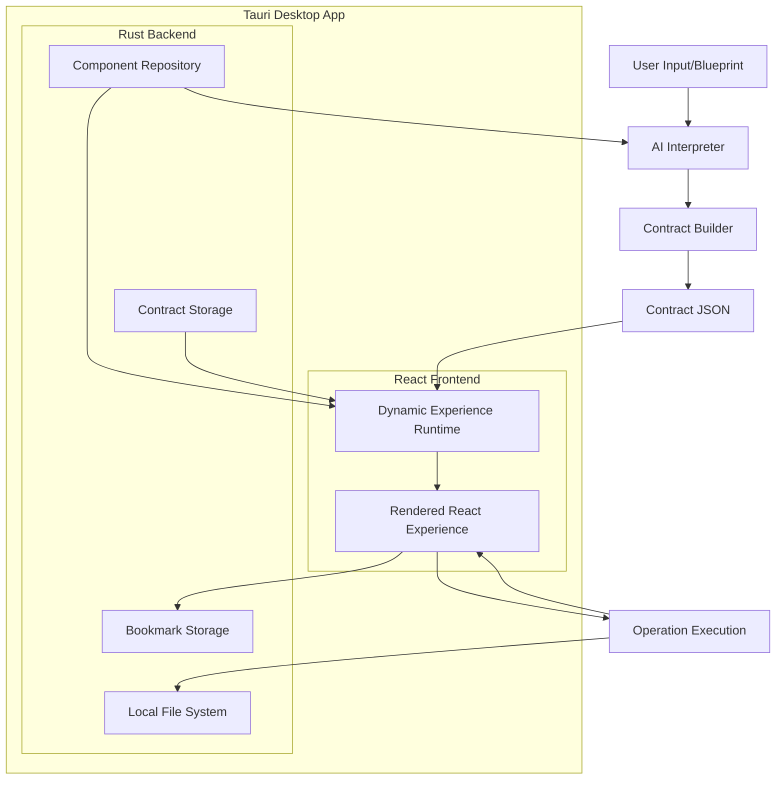

# Design Document

## Overview

The Dynamic Experience Runtime (DER) is a multi-layered system that transforms natural language descriptions into interactive desktop experiences through AI-generated contracts. Built with Tauri and React, the system combines the performance and security of native desktop applications with the flexibility of web technologies. The architecture follows a pipeline approach: Natural Language → Blueprint → Contract → Experience, with each stage having distinct responsibilities and clear interfaces.

The system is designed around six core principles:

1. **Dynamic Composition**: UI elements and operations are composed at runtime, not compile time
2. **Loose Coupling**: Components are bound through manifests and contracts, not direct dependencies
3. **Human-AI Collaboration**: The AI generates content while humans maintain full editorial control at every step
4. **Repository-Driven**: All components are discoverable through a centralized repository with rich metadata
5. **Real-Time Rendering**: Changes to contracts immediately reflect in the rendered experience
6. **Multi-Modal Operations**: Support for remote API, local device, and repository-sourced operations

## Architecture

### High-Level System Architecture



### Component Architecture

The system consists of five primary subsystems built on Tauri + React:

1. **AI Interpreter & Contract Builder** (React Frontend): Transforms natural language descriptions into structured blueprints and contracts
2. **Dynamic Experience Runtime (DER)** (React Frontend): Renders contracts into interactive React experiences
3. **Experience Editor** (React Frontend): Enables manual editing of blueprints, contracts, and experiences with conflict resolution
4. **Component Repository** (Rust Backend): Manages UI elements and operations with their manifests
5. **Persistence Layer** (Rust Backend): Handles bookmarking, sharing, and contract storage using local file system

### Technology Stack

- **Frontend**: React 18+ with TypeScript for dynamic UI rendering
- **Backend**: Rust with Tauri for native desktop capabilities and file system access
- **State Management**: React Context/Zustand for experience state management
- **Component System**: React components with dynamic imports for extensibility
- **Storage**: Local SQLite database via Tauri for contracts and bookmarks
- **IPC**: Tauri commands for secure frontend-backend communication

## Components and Interfaces

### AI Interpreter

**Responsibilities:**

- Parse natural language descriptions into structured blueprints
- Generate blueprints in consistent JSON format for user review
- Identify required UI elements and operations
- Generate clarifying questions when ambiguities are detected
- Preserve user manual edits through subsequent AI operations
- Assist in contract regeneration while respecting user modifications

**Key Interfaces:**

```typescript
interface AIInterpreter {
  parseDescription(description: string): Blueprint
  generateQuestions(blueprint: Blueprint): Question[]
  refineBlueprint(blueprint: Blueprint, answers: Answer[]): Blueprint
  generateContract(blueprint: Blueprint, userEdits?: ContractEdits): Contract
  preserveUserEdits(originalContract: Contract, userEdits: ContractEdits): Contract
}

interface Blueprint {
  description: string
  goal: string
  requiredCapabilities: string[]
  uiElements: UIElementRequirement[]
  operations: OperationRequirement[]
  ambiguities: Ambiguity[]
  userModifications?: UserModification[]
}

interface ParsedIntent {
  goal: string
  requiredCapabilities: string[]
  uiElements: UIElementRequirement[]
  operations: OperationRequirement[]
  ambiguities: Ambiguity[]
}
```

### Contract Builder

**Responsibilities:**

- Validate contract structure
- Resolve component dependencies
- Optimize operation execution order
- Generate final contract JSON

**Key Interfaces:**

```typescript
interface ContractBuilder {
  validateContract(contract: Contract): ValidationResult
  resolveComponents(contract: Contract): ResolvedContract
  optimizeExecutionOrder(contract: Contract): Contract
}

interface Contract {
  name: string
  version: string
  elements: UIElement[]
  operations: OperationBinding[]
  metadata: ContractMetadata
}
```

### Dynamic Experience Runtime (DER)

**Responsibilities:**

- Render React components from contract specifications
- Manage React component lifecycle and state
- Handle user interactions and event binding
- Execute bound operations via Tauri commands
- Update UI based on operation results

**Key Interfaces:**

```typescript
interface DynamicExperienceRuntime {
  renderExperience(contract: Contract): React.ComponentType
  updateExperience(experience: Experience, changes: ContractDelta): void
  executeOperation(operationId: string, inputs: any[]): Promise<any>
  bindEventHandlers(element: UIElement, bindings: EventBinding[]): void
}

interface Experience {
  id: string
  contract: Contract
  reactComponent: React.ComponentType
  state: ExperienceState
  operations: Map<string, Operation>
}

// Tauri Command Interface
interface TauriCommands {
  execute_operation(operation: string, inputs: any[]): Promise<any>
  save_contract(contract: Contract): Promise<string>
  load_contract(id: string): Promise<Contract>
  query_repository(criteria: ComponentCriteria): Promise<ComponentManifest[]>
}
```

### Component Repository

**Responsibilities:**

- Store and index UI element manifests
- Store and index operation manifests
- Provide component discovery APIs
- Manage component versioning and dependencies

**Key Interfaces:**

```typescript
interface ComponentRepository {
  queryUIElements(criteria: ComponentCriteria): UIElementManifest[]
  queryOperations(criteria: ComponentCriteria): OperationManifest[]
  registerComponent(manifest: ComponentManifest): void
  getComponent(id: string, version?: string): ComponentManifest
}

interface UIElementManifest {
  name: string
  version: string
  inputs: InputSpec[]
  outputs: OutputSpec[]
  capabilities: string[]
  renderFunction: string
  styleSchema: JSONSchema
}

interface OperationManifest {
  name: string
  version: string
  inputs: InputSpec[]
  outputs: OutputSpec[]
  capabilities: string[]
  executionType: 'remote' | 'local' | 'repository'
  implementation: OperationImplementation
}
```

### Persistence Layer

**Responsibilities:**

- Save and retrieve bookmarked experiences
- Manage contract storage and versioning
- Handle experience sharing and serialization
- Provide experience editing and duplication capabilities

**Key Interfaces:**

```typescript
interface PersistenceLayer {
  bookmarkExperience(experience: Experience): Promise<string>
  loadBookmarkedExperience(id: string): Promise<Experience>
  shareExperience(experienceId: string): Promise<ShareableContract>
  importSharedExperience(contract: ShareableContract): Promise<Experience>
  duplicateExperience(experienceId: string): Promise<Experience>
  updateExperience(experienceId: string, changes: ExperienceUpdate): Promise<void>
}

interface ShareableContract {
  contract: Contract
  metadata: ShareMetadata
  version: string
  checksum: string
}

interface ExperienceUpdate {
  blueprint?: Blueprint
  contract?: Contract
  preserveUserEdits: boolean
}
```

### Experience Editor

**Responsibilities:**

- Enable editing of blueprints, contracts, and rendered experiences
- Preserve user modifications during AI regeneration
- Provide conflict resolution for editing conflicts
- Support selective regeneration of contract sections

**Design Rationale:** The Experience Editor is a critical component that ensures human-AI collaboration by giving users full control over every step of the generation process. This addresses Requirements 2, 5, and 10 which emphasize manual editing capabilities and preservation of user modifications.

**Key Interfaces:**

```typescript
interface ExperienceEditor {
  editBlueprint(experienceId: string, blueprint: Blueprint): Promise<void>
  editContract(experienceId: string, contract: Contract): Promise<ValidationResult>
  regenerateWithPreservation(experienceId: string, sections: string[]): Promise<Contract>
  resolveEditingConflicts(conflicts: EditingConflict[]): Promise<Resolution[]>
  validateUserEdits(edits: UserEdit[]): ValidationResult
}

interface EditingConflict {
  type: 'ai-user-conflict' | 'dependency-conflict' | 'validation-conflict'
  location: string
  aiSuggestion: any
  userEdit: any
  resolutionOptions: ResolutionOption[]
}

interface UserEdit {
  location: string
  originalValue: any
  newValue: any
  timestamp: Date
  preserved: boolean
}
```

## Data Models

### Core Data Structures

```typescript
// Blueprint - Natural language input
interface Blueprint {
  description: string
  context?: string
  constraints?: string[]
  examples?: string[]
}

// Contract - Structured specification
interface Contract {
  name: string
  version: string
  elements: UIElement[]
  operations: OperationBinding[]
  layout: LayoutSpec
  styling: StyleSpec
  metadata: ContractMetadata
}

// UI Element in Contract
interface UIElement {
  id: string
  type: string
  properties: Record<string, any>
  dataBindings: DataBinding[]
  eventBindings: EventBinding[]
  children?: UIElement[]
}

// Operation Binding
interface OperationBinding {
  id: string
  operationName: string
  inputs: InputBinding[]
  outputs: OutputBinding[]
  triggers: TriggerSpec[]
}

// Data Binding
interface DataBinding {
  property: string
  source: 'operation' | 'state' | 'constant'
  sourceId: string
  transform?: TransformFunction
}
```

### Repository Data Models

```typescript
interface ComponentManifest {
  id: string
  name: string
  version: string
  type: 'ui-element' | 'operation'
  description: string
  capabilities: string[]
  dependencies: Dependency[]
  schema: JSONSchema
}

interface Dependency {
  type: 'ui-element' | 'operation' | 'library'
  name: string
  version: string
  optional: boolean
}
```

## Error Handling

### Error Categories

1. **Blueprint Parsing Errors**: Invalid or ambiguous natural language input
2. **Contract Generation Errors**: Unable to resolve components or create valid contract
3. **Runtime Errors**: Component rendering failures or operation execution errors
4. **Repository Errors**: Component not found or manifest validation failures

### Error Handling Strategy

```typescript
interface ErrorHandler {
  handleBlueprintError(error: BlueprintError): ErrorRecovery
  handleContractError(error: ContractError): ErrorRecovery
  handleRuntimeError(error: RuntimeError): ErrorRecovery
  handleRepositoryError(error: RepositoryError): ErrorRecovery
}

interface ErrorRecovery {
  strategy: 'retry' | 'fallback' | 'user-input' | 'graceful-degradation'
  message: string
  suggestedActions: string[]
  fallbackContract?: Contract
}
```

### Graceful Degradation

- **Missing Components**: Render placeholder elements with error messages
- **Operation Failures**: Display error states while maintaining UI functionality
- **Network Issues**: Cache contracts and enable offline rendering where possible
- **Invalid Contracts**: Attempt partial rendering with validation warnings

## Testing Strategy

### Unit Testing

- **AI Interpreter**: Test blueprint parsing with various input formats and edge cases
- **Contract Builder**: Validate contract generation and component resolution
- **DER Components**: Test individual UI element rendering and operation execution
- **Repository**: Test component storage, retrieval, and manifest validation

### Integration Testing

- **End-to-End Pipeline**: Blueprint → Contract → Experience rendering
- **Component Integration**: UI elements with bound operations
- **Repository Integration**: Component discovery and loading
- **Persistence Integration**: Bookmark and sharing functionality

### Performance Testing

- **Contract Generation Time**: Measure AI processing and contract building performance
- **Rendering Performance**: Test experience rendering with various contract sizes
- **Operation Execution**: Benchmark different operation types and data volumes
- **Repository Queries**: Test component discovery performance with large repositories

### User Acceptance Testing

- **Blueprint Accuracy**: Verify generated experiences match user intent
- **Usability**: Test experience interaction and user workflow completion
- **Sharing and Collaboration**: Validate bookmark and sharing functionality
- **Error Recovery**: Test system behavior with invalid inputs and edge cases

### Testing Tools and Frameworks

- **Frontend Unit Tests**: Vitest + React Testing Library for React components
- **Backend Unit Tests**: Rust's built-in test framework for Tauri backend
- **Integration Tests**: Tauri's WebDriver testing for end-to-end desktop app testing
- **Performance Tests**: React DevTools Profiler for rendering performance, custom benchmarks for AI processing
- **Contract Validation**: JSON Schema validation with custom contract validators
- **Mock Services**: Mock Tauri commands and external APIs for consistent testing
- **Desktop Testing**: Tauri's testing utilities for native desktop functionality

### Test Data Management

- **Blueprint Library**: Curated set of test blueprints covering various use cases
- **Contract Fixtures**: Pre-generated contracts for testing DER functionality
- **Component Mocks**: Mock UI elements and operations for isolated testing
- **Performance Baselines**: Established benchmarks for regression testing
